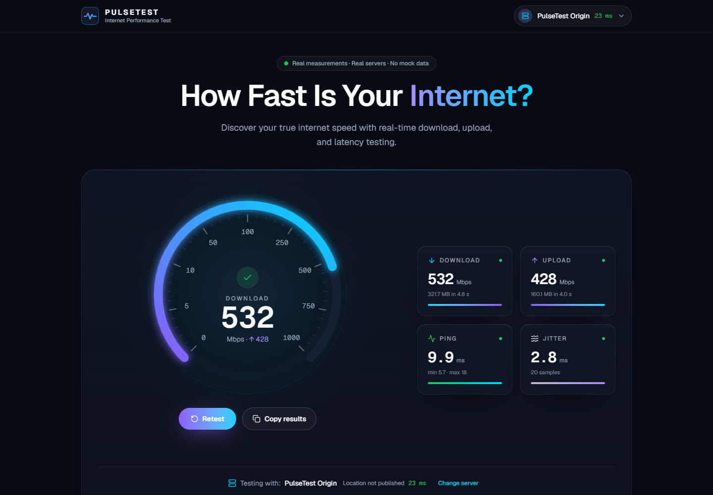
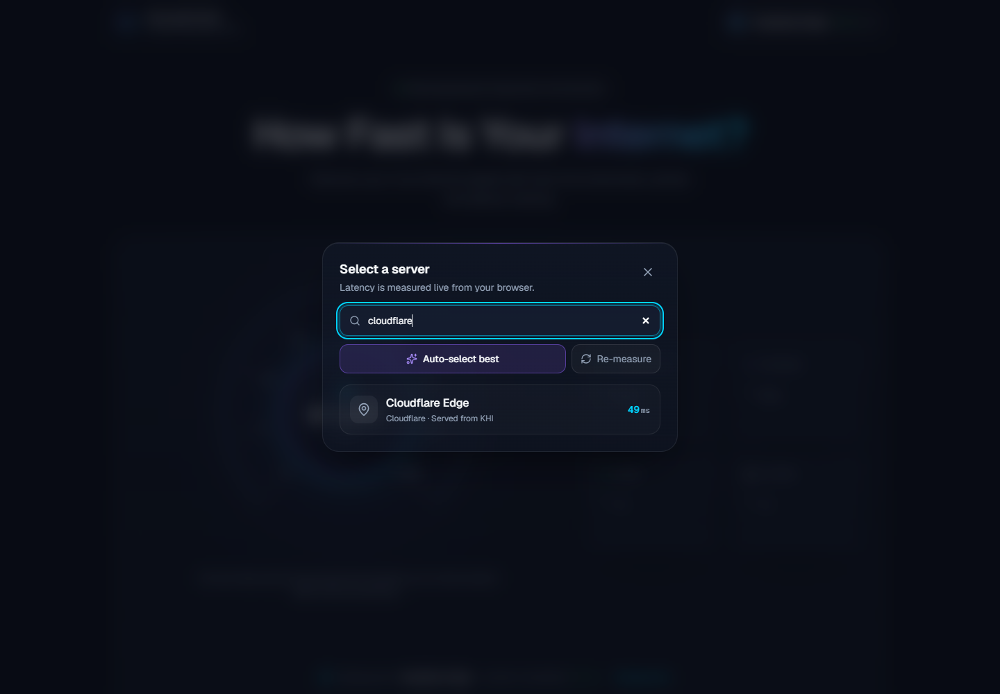
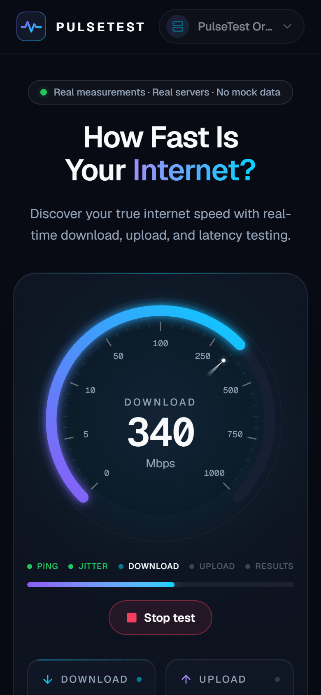

<div align="center">

# ⚡ PULSETEST

### Internet Performance Test

A premium, single-page internet speed test that measures **download**, **upload**, **ping** and **jitter** with real network transfers. No mock data and no random numbers.




</div>

---

## ✨ Features

- **Real speed-test engine:** download, upload, ping and jitter are measured from actual bytes and round trips, timed with `performance.now()`.
- **Glowing animated speedometer:** an SVG gauge with a gradient arc and needle on a 0–1000 Mbps scale, plus smooth spring-animated live readings.
- **Live test flow:** Ping → Jitter → Download → Upload → Results, with a phase stepper, progress bar and a **Stop** button.
- **Smart server selection:** every server's latency is measured live from your browser, the best one is picked automatically, and unreachable servers are never shown as available.
- **Results you can share:** a one-click **Copy results** button and a **Retest** button.
- **Built for mobile:** a responsive layout tested on phone and desktop.
- **Accessible:** keyboard-friendly modal with focus trap and Escape to close, screen-reader announcements, and support for reduced motion.
- **Protected API:** input validation, upload size limits and per-IP rate limiting.
- **SEO-ready:** metadata, Open Graph and Twitter cards.

<div align="center">

&nbsp;

</div>

## 🚀 Getting started

**Requirements:** Node.js 20+ and npm.

```bash
# 1. Install dependencies
npm install

# 2. (Optional) configure environment variables
cp .env.example .env.local

# 3. Start the dev server
npm run dev
```

Open **http://localhost:3000** and press **START**.

### Scripts

| Command | What it does |
| ------- | ------------ |
| `npm run dev` | Start the development server |
| `npm run build` | Create a production build |
| `npm start` | Run the production build |
| `npm run lint` | Lint with ESLint |
| `npx tsc --noEmit` | Type-check the project |

## 🧪 How it works

Measurement runs entirely in the browser ([src/lib/speedtest.ts](src/lib/speedtest.ts)), and the formulas live in [src/lib/calculations.ts](src/lib/calculations.ts).

| Metric | How it's measured |
| ------ | ----------------- |
| **Ping** | One warm-up request is discarded (it pays for DNS, TCP and TLS setup). Then 10 timed round trips give the average, minimum and maximum. |
| **Jitter** | 10 more round trips. Jitter is the average difference between consecutive ping samples. |
| **Download** | 4 parallel streaming connections run for about 10 s, and every byte received is counted. The first 1.5 s of TCP ramp-up is excluded from the final speed. |
| **Upload** | 3 parallel connections POST random, incompressible data for about 8 s, and bytes sent are counted from upload progress events. |

**Built-in safeguards:**
- **Caching is disabled everywhere.** Every request gets a cache-busting parameter and uses `no-store`, and the server sends `no-transform` so proxies can't cache or compress payloads.
- **Timeouts and stall detection:** a stalled download is aborted if no data arrives for 6 seconds.
- **Clean cancellation:** the Stop button aborts every request at once.
- **Bandwidth caps:** a test transfers at most 300 MB down and 150 MB up, so fast connections don't waste data.

## 🌍 Test servers

Two real servers are available by default:

| Server | Description |
| ------ | ----------- |
| **PulseTest Origin** | This app's own API routes (see below) |
| **Cloudflare Edge** | Cloudflare's public speed-test service. Its location (e.g. `KHI`) is detected live. |

### Adding your own servers

Set `SPEEDTEST_SERVERS` in `.env.local` to a JSON array, then **rebuild** the app:

```bash
SPEEDTEST_SERVERS='[{
  "id": "fra",
  "name": "Frankfurt",
  "provider": "Acme Hosting",
  "city": "Frankfurt",
  "country": "Germany",
  "pingUrl": "https://fra.example.com/api/speedtest/ping",
  "downloadUrl": "https://fra.example.com/api/speedtest/download?bytes={bytes}",
  "uploadUrl": "https://fra.example.com/api/speedtest/upload"
}]'
```

- `downloadUrl` must include the `{bytes}` placeholder.
- Remote servers must allow CORS requests from your site.
- To use another PulseTest deployment as a server, set `SPEEDTEST_CORS_ORIGIN` on that deployment.

### Environment variables

| Variable | Default | Purpose |
| -------- | ------- | ------- |
| `NEXT_PUBLIC_SITE_URL` | `http://localhost:3000` | Canonical / Open Graph URL |
| `SPEEDTEST_SERVERS` | *(Origin + Cloudflare)* | Custom server list (JSON) |
| `SPEEDTEST_INCLUDE_ORIGIN` | `true` | Show this app's own server alongside custom ones |
| `SPEEDTEST_ORIGIN_NAME` / `_CITY` / `_COUNTRY` / `_REGION` | — | How the origin server is labelled |
| `SPEEDTEST_MAX_DOWNLOAD_BYTES` | `26214400` (25 MB) | Max size per download request |
| `SPEEDTEST_MAX_UPLOAD_BYTES` | `8388608` (8 MB) | Max size per upload request |
| `SPEEDTEST_CORS_ORIGIN` | — | Let other sites use this app as a test server |

## 🔌 API

| Endpoint | Description |
| -------- | ----------- |
| `GET /api/speedtest/ping` | Empty, uncacheable response for latency |
| `GET /api/speedtest/download?bytes=N` | Streams exactly `N` bytes of random data (validated) |
| `POST /api/speedtest/upload` | Reads and discards the body, then returns `{ received, durationMs }`. Oversized bodies get `413`. |

All endpoints are **rate limited per IP** (requests and bytes per minute) and answer with `429` and `Retry-After` when the limit is hit.

> **ℹ️ Upload testing needs a real backend.** A browser can't measure upload speed against static files, so it needs an endpoint that accepts and discards data. This app includes one (`/api/speedtest/upload`). It works whenever the app runs on a server (`npm start`, Vercel, Docker and so on), but not on a static-only host.

## ☁️ Deployment

Deploy like any Next.js app: Vercel, Netlify, a Node server or Docker. Before going live:

- **Set your site URL:** `NEXT_PUBLIC_SITE_URL` should be your real domain.
- **On Vercel, lower the upload limit:** set `SPEEDTEST_MAX_UPLOAD_BYTES` below about 4.5 MB to stay under the function body limit.
- **Rate limits are per server instance.** The built-in limiter is in-memory, so on serverless or multi-instance hosting also enable your platform's rate limiting or firewall.
- **Run behind a proxy** that sets `X-Forwarded-For` (Vercel and most hosts do), so client IPs can't be spoofed.

## 📁 Project structure

```
src/
├── app/
│   ├── page.tsx                  # The single page (Server Component)
│   ├── layout.tsx                # Fonts, SEO metadata, viewport
│   ├── globals.css               # Theme colours & utilities
│   └── api/speedtest/
│       ├── ping/route.ts
│       ├── download/route.ts
│       └── upload/route.ts
├── components/
│   ├── speed-test-app.tsx        # Client root (shares server selection)
│   ├── speed-test.tsx            # Test flow, controls, results
│   ├── speedometer.tsx           # Animated SVG gauge
│   ├── server-selector.tsx       # Server modal with search & live latency
│   ├── result-cards.tsx          # Download / Upload / Ping / Jitter cards
│   └── navbar, hero, info-section, background, logo, toast
├── lib/
│   ├── speedtest.ts              # Browser measurement engine
│   ├── calculations.ts           # Mbps, jitter & formatting maths
│   ├── servers.ts                # Server config & validation
│   ├── rate-limit.ts, http.ts    # API protection & headers
│   └── use-server-probes.ts      # Live server latency probing
└── types/speedtest.ts
```

## 🛠️ Tech stack

[Next.js 16](https://nextjs.org) (App Router) · [TypeScript](https://www.typescriptlang.org) (strict) · [Tailwind CSS 4](https://tailwindcss.com) · [Framer Motion](https://motion.dev) · [Lucide](https://lucide.dev)

---

<div align="center">

Results depend on your device, browser, network and the selected server.

</div>
